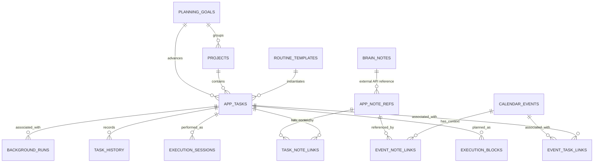

# Connected workspace architecture

2026-11-14. Application engineering design and first foundation implementation. No agents or memory-engine changes.

## The model

Pages are views of canonical domain records. Today is a projection, not a separate task table. Calendar renders fixed events, task execution blocks and deadlines. Graph renders relationships; it is not another authority for task state.

The Brain-to-reference line is a logical API association, not a PostgreSQL foreign key. Current Brain uses slug as its primary key and exposes a note version; it does not expose a separate immutable node UUID. App references get their own UUID, but rename/reuse reconciliation still needs a Brain contract.

## Audit findings

| Domain | Already implemented | Missing integration |
|---|---|---|
| Brain | Notes/body, areas, semantic relationships, aliases, dated items, changes, map cache, row-store amendment | Durable application-facing change notifications, stable identity/rename contract, rich temporal interpretation interface |
| Application | Goals, projects, recurring templates/occurrences/exceptions, tasks/dependencies, events, execution blocks/sessions, daily plans, history, retry receipts | Verified many-to-many note links, explicit event/task associations, common transactional change journal |
| Today | Reads the same task/event/block data, keeps optional current-task selection locally | Linked note/context presentation; no second Today task inventory needed |
| Calendar | Shared task blocks and deadlines plus fixed events; timezone/DST validation | Source-note provenance and date-meaning review/promotion |
| Graph | Existing live Brain viewer | A separately labelled operational overlay for tasks/events/goals and their current states |

Evidence: app/api/migrations/001_application.sql and 002_planning.sql, planning.py, Notes HTTP proxy, and read-only inspection of the sibling Brain migrations/API. Historical Markdown-authoritative D43 is superseded by the rows-as-Brain amendment and the owner's subsequent direction; it is not authority to reintroduce files.

Brain already has `dated_items` kinds event/review/start/end/decided. This is useful existing information but cannot be treated as a list of actionable deadlines. Do not copy or replace that extractor. Lia/Claude owns the semantic interpretation interface.

## Canonical records and new tables

| Table/view | Purpose and integrity |
|---|---|
| Existing app.tasks | One commitment/occurrence, objective, deadline, status, version; parent/dependency relationships retained |
| Existing app.execution_blocks | Planned work intervals; moving/splitting does not alter the objective/deadline |
| Existing app.execution_sessions | Human focus only; one open timer globally, completed segments retained. A focus handoff atomically closes the prior segment and starts the chosen task's segment |
| app.background_runs | Unattended work lifecycle and wall elapsed clock, independently related to a task; never included in human focus/session totals. Table only, no agent or runner |
| Existing app.calendar_events | Fixed appointments/occurrences, distinct from work blocks |
| app.note_refs | Local UUID → current single Brain namespace + external slug; last-verified revision/title and time. No note bodies. Never automatically import legacy mock `tasks.note_ref` values |
| app.task_note_links | Typed source/context/result association to task and note reference; local FKs; explicit unlink only |
| app.event_note_links | Source/context/result association to event and note reference |
| app.event_task_links | Explicit event/task context association. An event can have preparation/follow-up work later; context linkage alone does not invent a task or schedule |
| app.workspace_changes | Append-only application change journal, written in the same database transaction as the change; compact identifiers, changed fields, before/after state and reference IDs, no copied descriptions/note bodies |
| app.operational_edges | Read-only typed projection of existing FKs and new links. Labels are operational (source/context/result, scheduled_as, depends_on, etc.), never Lia semantic assertions |

Further proposed application tables (not included in the foundation migration): temporal observations/interpretations and their source-to-target bindings; per-consumer delivery/processing receipts; optional goal timeframes/milestones and secondary task-to-goal contributions if the owner needs them. Existing goals currently have no structured horizon/date fields and each task has one primary goal. Do not infer progress weights or completion of a life goal from a task count. Multiple goals and parallel plans already share projects/tasks; these extensions need concrete examples before locking their schema.

Current calendar events require timestamp intervals. Add a precision-preserving all-day/date-span representation before promoting date-only appointments; do not fabricate midnight UTC. Goal horizons, availability and coarse/relative dates are model gaps, not features implied by the new link tables.

Keep typed foreign keys instead of a generic unvalidated `(entity_type, entity_id)` write table. The graph projection can use typed node keys while its underlying records remain strongly constrained. No extra task/calendar/Today replicas, graph database, vector store, message broker or provider dependency.

## Temporal meaning: next contract, not an active parser

Examples below are synthetic design cases, not a configured classifier:

| Note content | Meaning to preserve | Possible projection after validation |
|---|---|---|
| Submit the proposal by 20 November | Date-only deadline | One task with due_date; no invented work block or exact hour |
| Dentist 20 November, 10–11, Berlin | Fixed event interval | One calendar event with named timezone and exact instants |
| Work on the proposal Friday afternoon | Flexible execution preference | A scheduling proposal; do not turn afternoon into unapproved numeric hours |
| Free next Tuesday 14–16 | Availability | Availability constraint, not an appointment or task |
| Review this in December | Coarse review date | A month-precision annotation; ask if a specific day is required |
| We met on 12 November | Historical fact | Stays context; no future commitment |
| Do this two hours before the meeting | Dependency/relative timing | Retain reference to the meeting, resolve only against its version |
| Exercise every Monday | Recurrence intent | Template/occurrences after validating required window/goal/duration |

Proposed interpretation record: source note reference + source revision; revision-bound anchor/span or fact identifier; original phrase; kind; date/date-time/interval/relative/coarse precision; local timezone and reference instant for relative language; negation/cancellation/conditional context; interpretation/validator version; state (uncertain/clear/applied/stale/rejected); optional application target reference. These are proposed fields for a later migration after the Brain interface is agreed, not a second semantic extraction engine.

Clear creation must mean an actionable intent, resolved target/date semantics, required fields and timezone, no conflicting existing commitment, and a current source revision. No numeric confidence cutoff is invented. Missing duration/time, conflicting facts, tentative language, old revisions or an unclear referent need clarification. An archival/historical date is not a failed task extraction.

A stable interpretation identity must survive note revisions: `(note, revision)` alone is not a commitment identity. Reprocessing, retries and minor wording changes must reconcile the existing target, not create another task. Keep explicit source-to-target binding and analysis receipts; do not auto-match only by title.

## Changes and future delivery

1. Save a canonical record through its owning service.
2. Record an application change atomically with application data. Brain needs its own approved change-feed/outbox contract; app code cannot make a Brain transaction atomic by appending a message afterward.
3. A future interpreter receives a source revision and returns bounded, typed interpretations. It does not receive arbitrary SQL permissions.
4. The application validates versions, required fields, duplication and permissions, then commits the target and source binding atomically; uncertain cases become a quiet, actionable clarification.
5. All interfaces query the updated records. Completed tasks disappear from active views but remain linked in history and graph.

No worker is implemented now. Journal sequence allocation is not global commit ordering and is not a reliable high-water delivery cursor. Future delivery uses per-consumer acknowledgments/claims, retries, deduplication and reconciliation; no exactly-once delivery claim. Provenance, correlation and causation distinguish owner edits from derived updates so consumers do not endlessly trigger one another.

The current Brain HTTP API has no verified change-feed endpoint or durable note-save event. Appending a post-save callback alone would lose changes when the application is down. A Brain-owned producer contract or an explicitly approved revision reconciliation reader is required before promising every-save interpretation.

## Completion, history and the graph

Completion is a state transition, not deletion. Preserve source notes, task objective/deadline, session segments, event associations and audit records. Reopen preserves prior history and follows the existing explicit progress-reset rule. Cancelled events and archived notes do not silently cancel tasks. Contradictory changes become reviewable conflicts.

Do not append every execution log to Brain or turn every task into a semantic memory node. The platform Graph should combine independently labelled Brain and operational layers, optionally showing completed/archived records. Operational edges reflect actual FKs and current state; Lia's curated meaning remains its own authority. Meaningful reflection can later enter memory through the existing selective-ingestion contract.

The future Graph adapter must resolve app note-reference UUIDs to the existing Brain node identity through their external IDs; a reference is not a second content node. Keep application resource IDs namespaced, merge note identities deliberately and distinguish unavailable/archived cached references instead of inventing live Brain nodes.

Traceable does not mean every session, log and background run is visible in the overview. Default to meaningful selected neighborhoods and current work, with execution/history detail available on request; bound graph queries and never load the entire journal into the browser.

## Feature impact

- Notes: small linked-work section in optional context; source-backed Create task/event actions; uncertainty prompts only when needed. Never annotate the written note body without an explicit write operation.
- Calendar: source note deep links and distinguish deadlines, appointments, work blocks and later availability; no duplicate events for task deadlines.
- Tasks: linked note/event context and provenance; one record even when displayed in several places.
- Today: current tasks/commitments drawn from canonical records, no new data inventory or dashboard noise.
- Graph: opt-in operational layer, typed connections and state/history filters. Existing Brain viewer remains unchanged until a reviewed overlay integration.
- Completed work: leave active lists; accessible in Completed/history and original note's linked context. No automatic Brain rewrite.

No immediate visual redesign in this database slice. Several open tasks/timelines are supported with one transferable human focus timer. Background runs have independent status/elapsed time. Independent dependencies and overlapping plans remain visible; a database cannot promise impossible capacity or guaranteed productivity.

The owner's revised third option distinguishes attention from unattended execution. A focus-switch command must validate both source/target versions, close the previous focus segment and start the new one at the same server instant in one transaction. Neither task goal/deadline changes. The owner delegated the interaction choice: use an explicit Focus selection for handoff; opening details, reading a note or checking Calendar must not steal focus. If no timer is running, selecting a task does not silently start one. This handoff is a documented next API/UI change, not enabled by the schema slice. Background job completion updates its own run; any task completion or Brain ingestion needs its separately approved policy.

The existing Kanban confirmation remains for starting/resuming a timer from a column move. An intentional Focus handoff transfers the already-running human clock; it does not start extra simultaneous timers or infer attention from navigation.

## Sequence and approval-sensitive decisions

1. Implement/test application links, transactional journal and edge projection in isolated PostgreSQL (this slice). No live DDL yet.
2. Wire minimal linked-context UI and atomic create-from-note API commands; extend operational Graph through a read-only bounded adapter. Review migration/backup/runtime grants before activation.
3. Agree Brain note identity/change/revision, temporal interpretation and reconciliation contracts with Claude; test date semantics, duplicate prevention and conflict handling on synthetic examples.
4. Implement the approved clear/uncertain promotion flow without autonomous scheduling or goal changes; verify disconnected clients, retries, undo/compensation and note archive/restore.
5. Only then implement specialized agents independently, with scoped commands and evaluations. The orchestrator comes last.

Still open: slug rename/reuse and Brain instance identity; meaning of month-only dates and default timezone for travel; allowed changes to already-started commitments; correcting/removing an interpretation after the owner edits its target; whether completion should produce an optional reflection rather than only app history; retention/delivery operations. Existing safe behavior remains until those policies are agreed.

## Research and tradeoffs

- Relational constraints keep link targets valid inside the application: https://www.postgresql.org/docs/18/ddl-constraints.html
- Separate calendar event/task/date/duration semantics, informed by iCalendar rather than flattening everything to timestamps: https://www.rfc-editor.org/rfc/rfc5545 and its task update https://www.rfc-editor.org/rfc/rfc10051
- A transactional outbox/journal prevents the database-update/notification gap within an owned transaction; retries still require deduplication: https://docs.aws.amazon.com/prescriptive-guidance/latest/cloud-design-patterns/transactional-outbox.html
- Preserve provenance instead of untraceable inferred relations: https://www.w3.org/TR/prov-dm/
- Manageable content and visible context inform the quiet UI; clinical productivity outcomes are not established by a schema: https://www.w3.org/WAI/WCAG2/supplemental/patterns/o5p03-manageable-quantity/

Standards are design inputs, not a requirement to implement full iCalendar interchange, event sourcing or a distributed microservice system. PostgreSQL plus the existing shared backend is sufficient for the foundation.

## Implemented and verified in this iteration

Staged migration 003, authenticated connection command/context routes, application journal triggers, current planning command correlation, isolated-runtime grants, and trusted preview restore handling. Six new tables and one read-only operational-edge view. No live database rollout, frontend redesign, agent, date classifier, new runner or Brain mutation.

The full application backend suite passed: **95 passed, 2 skipped** (environment-dependent); Ruff checks passed. New coverage exercises link persistence through completion/restart, offline unlink and idempotent replay, concurrent duplicate commands, stale versions on both endpoints, local FKs, missing/cancelled targets, CSRF/authentication, journal rollback/runtime permissions, background elapsed exclusion from focus totals and restore without duplicate history. Existing planning/Notes tests remain green. All verification used isolated PostgreSQL and synthetic Brain fixtures.

Next smallest end-to-end task: add an atomic source-note → task creation command plus a quiet linked-work section in optional note context. The command must create the canonical task and source link in one app transaction and the other views should read that same task. Date interpretation and agent execution remain separate subsequent components.

## 2026-11-15: source bridge activated

The next slice above is delivered: atomic task/fixed-event creation from a verified saved note, per-link revision provenance, existing-work linking/unlinking, and optional reverse context in work details. Application migrations 003/004 are now active after full backup/restore verification; the earlier staged-only status describes the previous iteration. Calendar and Today read the canonical work records. No interpretation worker, specialist agent, orchestrator or Brain schema/engine change was introduced. See `planning/note-work-bridge.md` for tests and current local runtime, and `requirements/contracts/lia-workflow-change-v1.md` for the unresolved durable producer boundary.
