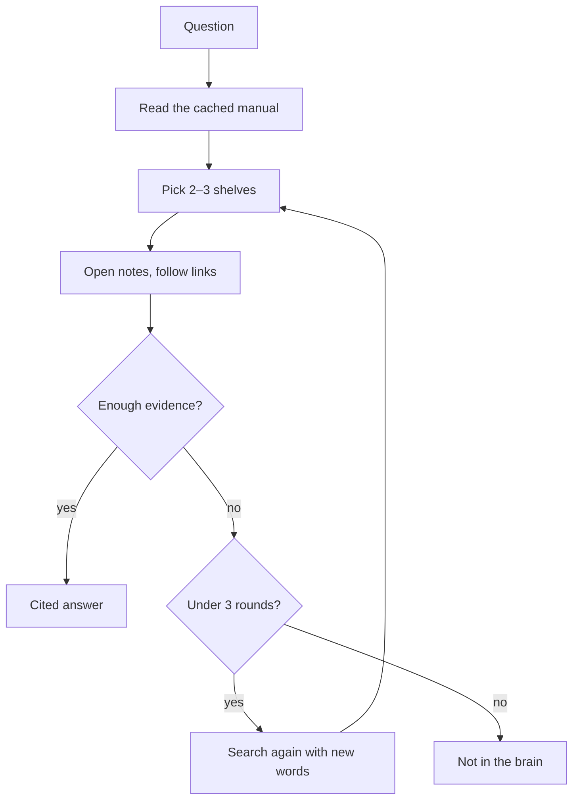

# Yggdras memory: the librarian plan

Oct 27, 2026 · @Manoj Saligrama Harisha

Yggdras should answer like a good librarian: read a small cached manual, walk to the right shelves, open only the few notes it needs, and look wider when they aren't enough. Today the whole-brain prompt is the most accurate option (23 of 24 hard questions), so the librarian has to match it while reading far less. Memory is the only focus until that is proven.

## The idea: an organised library and a librarian

The brain is built to be navigated in parts, not read whole. Loading everything wins while the brain is small, but every new note makes every question cost more.

*The librarian's path: one loop, at most 3 rounds.*

The cached manual is paid at a tenth on every question; only the opened notes cost full price, and the loop widens the search before giving up.

**The library**

- **Sections by life area** (thesis, work, German, job search), with shelves inside by kind of thing (people, projects, sources, ideas).
- **One node template for every note:** a label block (name, one-line description, aliases, type, area), short fact lines with sources, and a links section with relationship words. Every note follows it exactly, and code checks that. A note longer than about a page is split into two linked notes.

**Two maps, the guardrails**

1. **The shelf map:** one line per note, with its area and one-line description.
2. **The relationship map:** one line per link, like "jack-swigert, replaced, ken-mattingly", grouped under each note.

Code builds both maps from the notes, never by hand, so they can't drift. Markdown stays the source of truth.

**The cached manual**

The instructions, the node template with one example note, and the two maps sit at the start of every prompt and are cached, so they cost a tenth on each question. Only the notes picked for this question are loaded fresh. Stable parts go first, because caching only covers the beginning of the prompt.

**The librarian**

She reads the manual, picks two or three likely shelves (never just one), opens the few notes she needs and follows their links. If the evidence is missing, she searches again with new words, up to about three rounds, then answers with citations or says it's not in the brain.

**At scale**

When the maps grow too big for the prompt, they move into a database (the SQLite already in the plan). The librarian then asks it small questions through tools, and only a short top-level manual stays cached.

## What we already know

Seven experiments on the 42-note Apollo demo brain cost $1.47 in total. They settle three things: whole brain beats the current pipeline on hard questions, Graphify adds nothing to the brain path, and link verbs need a fixed list.

| Experiment | Result |
|---|---|
| 1, free link scan + verb checker | Recall 12 of 20; accepted new pairs plausible. Verbs matched only 27–29%, because the links use 89 verbs and 69 appear once |
| 2, harder questions (24) | Whole brain 23, current pipeline 19, pipeline + neighbour fallback 19, Graphify picks notes 13–14. Whole brain was cheaper per correct answer |
| 3, Graphify picker gap | The word-filter bug explained only 2 of 10 misses; seeding Graphify with our picks got 33–34 of 35, slower (8.2 s vs 3.2 s) |
| 4, graphify update as the map | Same links as our structural pass, but every link becomes a plain "references" edge |
| 5, deep mode, smaller budget | No recall gain, no real verbs |
| 6, upstream fixes | None released, including 0.9.96 |
| 7, the video's claims | No token saving on code or notes; Graphify used 1.1–1.3x a plain agent's tokens. Both agents cost 4–5x our pipeline per correct answer |

On the original 35 questions, the current pipeline scores 35 of 35 at about $0.0006 per correct answer and 3.2 s median. One hard question (x23) is missed by every option.

**Gaps in the baseline:** cost per correct answer for each option on the hard test, warm and cold cache timings, and several run times marked "not reported".

## What the studies and builders say

The research matches our result: loading everything wins while the knowledge is small, and navigating parts wins as it grows. Nobody has published this exact combination of shelves, two maps and a strict factual test.

- **Loading everything ("cache-augmented generation")** beat search in 5 of 6 tests on 21k–85k-token collections, but its lead shrank with size and search won at 85k. ([Chan et al.](https://arxiv.org/pdf/2412.15605))
- **Full text vs search:** full text won by 3.6–13.1 points on average. Search failed on multi-step, vague and "whole picture" questions, the same types whole brain won in Experiment 2. **Self-Route** answers from search first and widens to full text only when the model says it can't answer, close to full-text accuracy at 39–62% lower cost. ([Li et al.](https://arxiv.org/html/2407.16833v1))
- **Anthropic:** under 200,000 tokens, skip retrieval and put everything in the prompt; caching cuts latency over 2x and cost up to 90%. Above that, meaning search + keyword search + reranking cut retrieval failures by 67%. ([Contextual Retrieval](https://anthropic.com/news/contextual-retrieval))
- **Long prompts degrade:** facts in the middle can drop 20+ points, and some models slip around 32k–64k tokens. Our brain is about 34k tokens. ([decision framework](https://tianpan.co/blog/2026-04-09-long-context-vs-rag-production-decision-framework))
- **Walking one branch is risky:** if the first folder choice is wrong, the answer becomes unreachable. Picking several areas, or searching all levels at once, does better (RAPTOR, TreeHop).
- **Close relatives:** Karpathy-style LLM wikis (an index read first, then only the needed pages, [DecodingAI](https://www.decodingai.com/p/llm-wiki-agent-memory)); [PageIndex](https://pageindex.ai/blog/claude-code-agentic-rag) (a vectorless tree per document, navigated by the model); [Neo4j](https://neo4j.com/blog/agentic-ai/scaling-karpathy-llm-wiki-graph/) (move links into a database as the wiki grows, built straight from markdown links).
- **Note size:** builders aim for one idea per note, often about 256–512 tokens, with a label block on top ([Basic Memory](https://docs.basicmemory.com/concepts/knowledge-format), [Atomic Knowledge](https://github.com/Nimo1987/atomic-knowledge)).
- **A warning:** [one memory project](https://github.com/tsantoso79/agentic-graphrag-memory) measured that most memories it pulled in weren't useful, which is why every change here gets tested.

## Roadmap

Measure first, then build in small steps, each checked against the same hard test.

1. **Baseline (the "before" score).** Make one table from REPORT.md and existing results; rerun only the missing cells (cost per correct answer per option, warm and cold cache, run times). Add 20–30 hard questions, mostly ones that need notes from different shelves, plus a held-out set nobody tunes on.
2. **Lock the node template v1.** Start from the frozen format (D31); add an area field, a soft size limit and a fixed list of 15–20 link verbs with their opposites. This amends D31, so it goes through the register.
3. **Plan the library.** The agent proposes sections, shelves and labels for the Apollo brain in writing. Approve before any file moves.
4. **Build the structure and the two maps** in parallel on top of the template. Code generates the maps and checks every note against the template.
5. **Cache the manual** (instructions, template with an example, both maps), stable parts first.
6. **Run the experiments** below, one change at a time.
7. **Connector.** A local MCP server for the Claude desktop app so answers can be judged by hand; ratings feed the hard test.
8. **Database** once the maps outgrow the prompt.

## Planned experiments

Every experiment runs on the same expanded hard test, at least 3 runs per arm, with the whole-brain prompt as the reference score. Pass bars are written before running. Cap: $5 per experiment, about 2 cents per question.

| # | Hypothesis | Setup | Metrics | Pass bar |
|---|---|---|---|---|
| A | The structured library alone doesn't lower accuracy | Current pipeline on the restructured brain vs on the old brain | Score, $ per correct, tokens, seconds | Score not lower than before |
| B | Caching the maps only, not the brain (two maps + template), lets the librarian match the whole-brain cache | Read manual, pick 2–3 shelves, open notes, follow links, answer | Same, plus notes opened per question | Within 1 question of whole brain, reading far less |
| C | A look-wider loop fixes "not enough evidence" misses | B + up to 3 search rounds with new words when evidence is missing | Same, plus rounds used and misses fixed | Recovers at least half of B's evidence misses |
| D | A wide net improves the first pick | Top 20 notes by meaning + keywords (small embedding index), then the model picks | Same, plus shortlist recall | Shortlist holds the answer note in at least 95% of questions |
| E | Wide net + loop together beat each alone | D first, then C's loop if needed | Same | Beats B, C and D, or matches whole brain at lower reading |
| F | The design holds as the brain grows | Add real decoy notes at 50, 150, 500 and 1,000 notes; rerun whole brain and the best librarian | Score and cost per size | Shows where whole brain falls and where the librarian should take over |
| G | Graphify can compete when given our map | Final benchmark only, bar written first | Same | Beats or matches the best librarian at lower cost |

**Your prediction to test in B:** about the same cost as whole brain at this size, similar accuracy, and possibly slower, since the librarian needs a pick step before the answer.

## Rules that keep us honest

1. **Write the bar before the test,** especially for ideas we like.
2. **One change per round,** compared with the best version so far. Keep the winner, drop the loser.
3. **Race a plain baseline.** The librarian must beat or match the whole-brain prompt on the same questions, or the idea waits.
4. **Label every miss:** wrong notes found, right notes but bad answer, or not enough notes. Fix only the step that failed.
5. **Write the breaking cases first:** questions across three shelves, a note on the wrong shelf, a vague label.
6. **Keep a held-out set** the system is never tuned on, and add fresh questions every few rounds.
7. **Code builds the maps;** markdown stays the source of truth.
8. **Plan before build:** the agent proposes, Manoj approves.

## Open decisions

- **Node template v1:** which fields to add (area, keywords), the soft size limit, and the fixed verb list. Amends D31.
- **Sections and shelves** for the Apollo brain, and later for the real brain.
- **Cache length:** 5 minutes or 1 hour, since questions come spread across the day.
- **When to move the maps to a database:** set from experiment F, not guessed.
- **D32:** Graphify out of the brain path, with a fair rerun in the final benchmark (G).
- **Question x23:** a badly written question or a real gap, checked before the expanded test is frozen.

## Sources

- [Don't Do RAG: When Cache-Augmented Generation is All You Need for Knowledge Tasks](https://arxiv.org/pdf/2412.15605)
- [Retrieval Augmented Generation or Long-Context LLMs?](https://arxiv.org/html/2407.16833v1)
- [Introducing Contextual Retrieval (Anthropic)](https://anthropic.com/news/contextual-retrieval)
- [Long-Context Models vs. RAG: a production decision framework](https://tianpan.co/blog/2026-04-09-long-context-vs-rag-production-decision-framework)
- [LLM wiki as agent memory (DecodingAI)](https://www.decodingai.com/p/llm-wiki-agent-memory)
- [PageIndex and Claude Code agentic RAG](https://pageindex.ai/blog/claude-code-agentic-rag)
- [Scaling Karpathy's LLM wiki with a graph (Neo4j)](https://neo4j.com/blog/agentic-ai/scaling-karpathy-llm-wiki-graph/)
- [Basic Memory knowledge format](https://docs.basicmemory.com/concepts/knowledge-format)
- [Atomic Knowledge](https://github.com/Nimo1987/atomic-knowledge)
- [agentic-graphrag-memory](https://github.com/tsantoso79/agentic-graphrag-memory)
- Experiment results: evals/experiments/graphify-six/REPORT.md in the Yggdrass-OS repo
