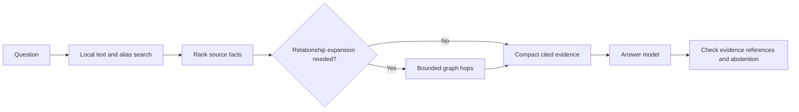

# Yggdras memory-system review

Research date: 25 October 2026. Status: advisory review, not an approved specification or register amendment.

## Main finding

The main problem is the runtime and the way we are interpreting our experiments. The notes, stable identities, provenance rules, reviewed writes, and rebuildable indexes are useful foundations. We are spending too much model context on navigation, testing a restricted graph entry point as though it represented a complete memory-retrieval system, and using a small static demo to guide decisions about a changing personal memory.

My earlier recommendation to stop investigating Graphify retrieval was too broad. The measured result is narrower: **the tested raw-question, graph-only route performed worse on this Apollo set.** It does not establish that a properly seeded hybrid route, Graphify's documented assistant workflow, or graph-assisted memory in general would perform worse.

This is a focused review across 26 primary papers, official documentation pages, and first-party methodological guides, not an exhaustive survey of every memory product. Vendor benchmarks are treated as their authors' experiments, not independent proof that their product would win here. No new answering-model evaluations were run for this review.

## What exists, and what does not

At Phase 1b we have the node format, gateway skill, deterministic structural map, installed Graphify, and experiments. The connector, production memory reader, conversation filter, and orchestrator are later phases. An unbuilt Phase 3 feature is not a current implementation bug.

Local evidence:

- [Locked plan](../../planning/locked-plan-v1.md), especially the revision, Phase 2 connector, Phase 3 filter, and merge/history sections.
- [Frozen node identity and fact format](../decisions/D02-node-identity.md).
- [Gateway rules](../../skills/gateway/SKILL.md).
- [Phase 1b findings](../../requirements/scoping-phase-1b.md).
- [Retrieval experiment](../../evals/experiments/retrieval/README.md), [machine-readable comparison](../../evals/experiments/retrieval/comparison.json), and [complete answers](../../evals/experiments/retrieval/answers.md).

The demo contains **42 notes plus an index**. The notes total **34,261 bytes and 4,748 whitespace-delimited words**. Those are measured sizes, not exact Claude token counts. The earlier spoken figure of 4,300 tokens across 25 notes was unverified and incorrect. The large evaluation token totals include repeated model context, not just note contents.

## Confirmed mistakes and the proposed corrections

### 1. We used an oversized runtime for simple retrieval

**Evidence.** The fresh plain-index condition processed 1,680,280 tokens over 25 questions, about 67,211 per question. One simple launch-date question used four model calls with input contexts of 11,371, 12,732, 16,889, and 17,431 tokens. That is 58,423 input tokens processed cumulatively, plus 351 output tokens. It was never a 58,000-token note or a 58,000-token simultaneous context window. The final transcript reports 52,355 cache-read tokens for that question.

**Mistake.** A general coding-agent harness, broad tool context, and repeated model-directed file reads are dominating a tiny lookup. Fresh agents were appropriate for isolation; loading that entire harness was not necessary to answer this question. Caching lowers the charge but does not remove the repeated-context accounting.

**Proposed correction.** Use a compact reader with the actual brain tools. Let ordinary code retrieve and assemble evidence before the answer call. Keep an agentic investigation route for questions that need it. Anthropic recommends starting with simple workflows and minimal tool surfaces; the 2026 LongMemEval-V2 work also shows why coding-agent memory is a latency/accuracy tradeoff, rather than a universal mistake. [Simple agents/workflows](https://www.anthropic.com/research/building-effective-agents), [context engineering](https://www.anthropic.com/research/effective-context-engineering-for-ai-agents), [LongMemEval-V2](https://arxiv.org/abs/2605.12493).

**Tradeoff.** A fixed fast path gives up some autonomy. Escalation preserves flexibility for hard questions. No smaller model or numerical latency target has been selected by this review.

### 2. We treated a lexical graph entry point as a complete semantic retriever

**Evidence.** In the installed 0.9.95 package, `skills/claude/references/query.md` explicitly describes label-based matching without synonyms or stemming and requires constrained expansion against the graph vocabulary. Its documented workflow uses that expanded query for traversal. Our R3 prompt intentionally required the unchanged natural-language question and prohibited revised queries or fallback reads.

**Mistake.** The experiment answered a legitimate narrow question, but I overstated what it settled. Its 21/25 result is not a test of the complete documented assistant workflow. Four answerable questions failed because the necessary notes never entered the candidate set: tank manufacturer, Apollo 1 fire, Saturn V developer, and capsule communicator. A token budget cannot repair a missing seed.

**Proposed correction.** Preserve this result as a raw-query ablation. For a future product comparison, evaluate the documented expansion route separately and charge its extra model/tool work. Also evaluate a local text-search route over facts, names, descriptions, and aliases, with optional graph expansion from resolved seeds. The installed CLI already accepts explicit seeds; this can be explored outside Graphify without editing its package. No upgrade is implied. [Graphify query guide](https://github.com/Graphify-Labs/graphify/blob/v8/graphify/skills/claude/references/query.md).

Graphify's current maintainer benchmark uses a distinct hybrid memory harness with local embeddings and graph expansion. Its claims cannot be transferred to our installed CLI test, and its model/provider settings do not override our Anthropic-only decision. [Graphify benchmark methodology](https://github.com/Graphify-Labs/graphify/blob/v8/BENCHMARKS.md).

### 3. Our experimental route discarded the source-text fallback that major graph systems preserve

**Evidence.** R3 was allowed to read only paths emitted by one query. For the tank question, an opened note contained a link to the builder, but the builder's fact note was outside that permitted set. The agent's refusal was faithful to the condition.

**Mistake if promoted to production.** Graph candidate selection becomes an absolute evidence bottleneck. A weak label match can make an existing fact appear absent. This is a route constraint in an experiment, not proof that the brain has forgotten the fact.

Microsoft GraphRAG local search combines graph entities and relationships with associated source chunks, then prioritizes the context. HippoRAG 2 integrates passage nodes and retains a passage-retrieval fallback when graph seeds are absent. LightRAG retrieves entity/relation information together with source text. These are architectural patterns to learn from, not three dependencies to install. [GraphRAG local search](https://microsoft.github.io/graphrag/query/local_search/), [HippoRAG 2](https://arxiv.org/html/2502.14802v1), [LightRAG](https://arxiv.org/html/2410.05779v1).

**Proposed correction.** Retrieve candidate facts by text/aliases first; optionally expand relevant relationships; rank and deduplicate; return a compact source-bearing evidence bundle. Add semantic retrieval if paraphrase tests show the lexical route needs it. A local BM25 baseline is available without adopting a graph database; SQLite FTS5 is one implementation option, not a new approved store. Any such cache remains derived from Markdown. [Contextual retrieval](https://www.anthropic.com/research/contextual-retrieval), [FTS5](https://www.sqlite.org/fts5.html).

**Tradeoff.** Hybrid retrieval adds ranking and index-maintenance work. Start with the cheapest baseline that covers observed misses.

### 4. We are conflating navigation hints, factual evidence, and a correct-looking answer

**Evidence.** Wiki-first produced 25 correct answer contents, but one commander answer relied on a link/index description instead of opening the required fact note. Another answer added a mechanism from frontmatter. Some agents also requested paired Read calls despite the one-file instruction. The report correctly flags these deviations; they are not clean protocol passes.

**Mistake.** Prompt rules alone did not establish grounded retrieval. An index description and an extracted edge can point to evidence without carrying the source provenance required to assert it as fact. Our structural edges preserve reasons and file locations, but that does not automatically make them equivalent to cited fact lines.

**Proposed correction.** The connector should return routing metadata separately from answer evidence. Evidence items should identify the literal fact, provenance tag, source node and source anchor. Verify that cited evidence was supplied; separately audit whether it supports the claim. Code can validate references and structure, but it cannot guarantee semantic truth merely by requiring a citation. Keep answer correctness, evidence coverage, unsupported claims, and tool compliance as separate scores. Tool design should return meaningful compact context and be evaluated on realistic tasks. [Effective agent tools](https://www.anthropic.com/research/writing-tools-for-agents).

The frozen format need not be rewritten to explore a derived evidence view. Treating authored links themselves as admissible facts would require an explicit provenance-policy decision.

### 5. Our small, static evaluation is being asked to answer a much larger question

**Evidence.** The current corpus is 42 short Apollo notes with 25 repeatedly used questions. The index condition is already at 25/25. Alias handling has no real-corpus coverage. Each current retrieval condition was measured once, with some protocol deviations and different actual launch overlap. Public Apollo facts may also be available in a model's prior knowledge, making source checks essential.

**Mistake.** This is a useful smoke/regression test. It cannot establish reliable personalized memory, the usefulness of graph reasoning at scale, or an isolated interactive latency guarantee. Repeatedly tuning against the same questions also risks evaluation overfitting.

**Proposed correction.** Retain Apollo as a smoke test. Add held-out synthetic personal scenarios with counterfactual facts, multiple updates, ambiguous names, paraphrases, relative dates, missing information, and distracting related notes. Test all required evidence sources, not just whether one useful note was found. Compare retrieval recall under a context budget, answer correctness with oracle evidence, and full end-to-end outcomes separately. LongMemEval covers cross-session, updates, time, and abstention; LoCoMo covers long conversational histories; LoCoMo-Plus highlights constraints that must be applied even when not explicitly restated in a question. [LongMemEval](https://arxiv.org/html/2410.10813v1), [LoCoMo](https://aclanthology.org/2024.acl-long.747/), [LoCoMo-Plus](https://arxiv.org/abs/2602.10715).

These are proposed test categories, not owner-approved acceptance thresholds. Do not launch another large paid run before fixing the runtime and defining the comparison.

### 6. We are mixing service startup, retrieval, and answer generation in the latency discussion

**Evidence.** The measured averages were about 9.6 seconds for index answers and 14.7 seconds for graph-assisted responses. Standalone graph CLI probes averaged 7.2 seconds including process startup. That does not identify the intrinsic BFS time, nor measure a warm persistent server. The scored batches had first-batch peak concurrency six, and final-batch peaks three/four/five.

**Mistake.** Quoting “15 seconds for a query” without keeping these boundaries explicit suggests a product property we have not measured. Likewise, cumulative processed tokens, fresh input, cache reads/writes, emitted answer tokens, and total account charges are different quantities.

**Proposed correction.** Measure isolated requests separately from batch throughput. Record cold start, graph load, candidate search, evidence assembly, model time to first token, and complete answer time; report median and tail latency along with actual context size and cost. Compare a persistent read service with per-question CLI startup before choosing a deployment route. Mem0's paper explicitly separates search latency from total response latency; its numerical results are not predictions for this laptop or model. [Mem0](https://arxiv.org/html/2504.19413v1).

### 7. We have not yet tied link discovery to the outcome that makes it valuable

**Evidence.** Phase 1b explicitly makes discovery a core value. Arm A recovered 11/20 deleted pairs at no model cost, but also produced six wrong new proposals among 34 new pairs. Graphify's original arms recovered 9 and 7 and did not supply reviewable per-link reasons in those outputs. These local results establish costs and tradeoffs, not a general discovery winner for personal knowledge.

**Mistake.** A count of recovered links or a dense attractive graph is not the same as improved recall, a useful new connection, or a cheap review process. We also must not decide discovery's value using only a separate retrieval-speed test.

**Proposed correction.** Evaluate link proposals by supported precision, missed meaningful relations, novelty beyond name matching, reviewer effort, and usefulness on held-out tasks. Require reasons backed by source facts. Keep A as a candidate baseline rather than interpreting “free” as “free of review cost.” A-MEM is a research example of atomic notes, contextual linking, and evolving organization; it does not establish that autonomous edits should bypass our review policy. [A-MEM](https://arxiv.org/html/2502.12110v1).

## Lifecycle risks to resolve before the capture/filter phase

These are future-design gaps, not reasons to replace the current Markdown store now.

**Preserve recall separately from distilled facts.** The plan deletes source transcripts after a day or two. With only a summary left, a missed detail or disputed extraction may become impossible to reconstruct. MemGPT/Letta distinguish active context, searchable conversation history, and archival material. Choose a deliberate, privacy-aware retention policy and source anchors; never silently retain material the owner asked to delete. A source archive must have a defined authoritative role, not become a second competing set of edited facts. [MemGPT](https://arxiv.org/html/2310.08560v1), [Letta stateful memory](https://docs.letta.com/v1-sdk/concepts/stateful-agents).

**Test more than one historical update.** Our inline “was … changed … by …” format preserves a simple transition and original citation, which is useful. The tested example does not establish what happens after several changes, delayed corrections, scheduled future changes, or an “as of” query. Distinguish when a fact was valid from when it was learned. Zep's temporal model and source-episode links illustrate the distinction; adopting those ideas does not require reinstating Graphiti or trusting its automatic extraction. [Zep temporal memory](https://arxiv.org/html/2501.13956v1).

**Define consolidation operations and their review.** Capture needs explicit handling for new facts, duplicates, corrections, deletions, and no change. Mem0 makes these operations explicit; we should test our chosen semantics, not copy its deletion policy automatically. The wider memory survey treats formation, evolution, and retrieval as separate lifecycle concerns. Retrieval-only success leaves the first two unproven. [Mem0 operations](https://arxiv.org/html/2504.19413v1), [memory-system survey](https://arxiv.org/html/2512.13564v2).

## What we should keep

- Human-editable canonical notes; stable IDs and alias resolution; citations and stated/derived distinctions.
- Deterministic, rebuildable structural indexes separate from inferred proposals.
- Reviewed writes and the existing provider/privacy decisions.
- A small working digest instead of the whole brain in every prompt. The locked plan already proposes this.
- Delaying orchestration until there are useful workers. More agents are not the cure for retrieval overhead.
- The distinction between personal operational memory and the later library/document corpus.

Different query types justify different retrieval paths. GraphRAG global search synthesizes community reports for broad questions; RAPTOR provides hierarchical summaries for long documents. Neither observation makes either mechanism necessary for a short deadline lookup. [GraphRAG global search](https://microsoft.github.io/graphrag/query/global_search/), [RAPTOR](https://arxiv.org/html/2401.18059v1).

Forte's second-brain guidance emphasizes actionable projects and useful output. Our own “daily use beats planning” principle points the same way: success should include capturing a real decision, finding it later, applying a correction, and completing a real task. A prescribed folder taxonomy is not evidence that our current entity folders are wrong. [Second-brain principles](https://fortelabs.com/blog/basboverview/).

## Recommended next sequence — for owner review

1. Record the scope correction to the retrieval finding; keep the raw results intact. Resolve the pending Phase 1b decisions using separate discovery and retrieval evidence.
2. Scope the small Phase 2 connector around compact search, evidence-bearing reads, and optional graph expansion. Keep IDs/large maps internal when the model only needs a few facts.
3. Measure that reader with isolated cold/warm requests and a small held-out test. Add complexity only for diagnosed misses; do not run a framework tournament yet.
4. Before automated capture, settle source retention, multiple-update history, deduplication, and reviewed correction/deletion semantics. Then exercise the loop on real use under the owner's privacy choices.

Proposed retrieval shape, not an implemented change:

No production files, canonical notes, gateway, installed Graphify, frozen schema, plan, or decision register were changed for this review. No commits, PRs, upgrades, or paid evaluation runs were made.

## Source map

All accessed 25 October 2026. Historical papers inform design patterns; their old model benchmarks are not measurements of our current model. Current online Graphify documentation may differ from the pin; the query-expansion finding was independently verified in the installed package.

| # | Primary source | Relevance and limit |
|---|---|---|
| 1 | [Graphify project](https://github.com/Graphify-Labs/graphify) | Current product scope and entry points; not a guarantee about the installed pin. |
| 2 | [Graphify query guide](https://github.com/Graphify-Labs/graphify/blob/v8/graphify/skills/claude/references/query.md) | Vocabulary expansion and traversal workflow; also checked locally. |
| 3 | [Graphify benchmark methods](https://github.com/Graphify-Labs/graphify/blob/v8/BENCHMARKS.md) | Distinct hybrid harness and separate recall/QA metrics; maintainer-authored. |
| 4 | [Microsoft GraphRAG local search](https://microsoft.github.io/graphrag/query/local_search/) | Graph information plus source text and bounded context. |
| 5 | [Microsoft GraphRAG global search](https://microsoft.github.io/graphrag/query/global_search/) | Community-report synthesis for corpus-level questions. |
| 6 | [LightRAG](https://arxiv.org/html/2410.05779v1) | Specific and broad retrieval with source chunks. |
| 7 | [HippoRAG 2](https://arxiv.org/html/2502.14802v1) | Passage integration, seed selection, and fallback. |
| 8 | [RAPTOR](https://arxiv.org/html/2401.18059v1) | Hierarchical summaries for long-document retrieval. |
| 9 | [MemGPT](https://arxiv.org/html/2310.08560v1) | Working context separated from searchable recall/archive. |
| 10 | [Letta stateful agents](https://docs.letta.com/v1-sdk/concepts/stateful-agents) | Current memory/message persistence model. |
| 11 | [Mem0 paper](https://arxiv.org/html/2504.19413v1) | Extraction/update operations and latency decomposition; author-run comparisons. |
| 12 | [Zep paper](https://arxiv.org/html/2501.13956v1) | Episodes, provenance, and valid versus ingestion time. |
| 13 | [Graphiti search documentation](https://help.getzep.com/graphiti/working-with-data/searching) | Combined lexical/semantic search and optional graph-distance ranking. |
| 14 | [A-MEM](https://arxiv.org/html/2502.12110v1) | Atomic memory notes, links, and evolution; autonomous behavior is not our write policy. |
| 15 | [LongMemEval](https://arxiv.org/html/2410.10813v1) | Dynamic personal-memory abilities and indexing/retrieval/reading separation. |
| 16 | [LongMemEval-V2](https://arxiv.org/abs/2605.12493) | 2026 accuracy/latency tradeoff and environment experience; work in progress. |
| 17 | [LoCoMo](https://aclanthology.org/2024.acl-long.747/) | Long, multi-session conversational-memory evaluation. |
| 18 | [LoCoMo-Plus](https://arxiv.org/abs/2602.10715) | Implicit user constraints beyond explicit fact recall; preprint. |
| 19 | [Memory in the Age of AI Agents, v2](https://arxiv.org/html/2512.13564v2) | Taxonomy and lifecycle coverage; a survey, not one winning architecture. |
| 20 | [Building effective agents](https://www.anthropic.com/research/building-effective-agents) | Match runtime complexity to task complexity. |
| 21 | [Writing effective tools](https://www.anthropic.com/research/writing-tools-for-agents) | Compact responses, realistic evals, and fewer unnecessary tool surfaces. |
| 22 | [Context engineering](https://www.anthropic.com/research/effective-context-engineering-for-ai-agents) | Minimize irrelevant context and retrieve on demand. |
| 23 | [Contextual retrieval](https://www.anthropic.com/research/contextual-retrieval) | Text-context enrichment, lexical/semantic complementarity, and reranking. |
| 24 | [Building a Second Brain](https://fortelabs.com/blog/basboverview/) | Human knowledge work and actionability; not a retrieval benchmark. |
| 25 | [SQLite FTS5](https://www.sqlite.org/fts5.html) | Local full-text search, BM25 ranking, and snippets as an implementation option. |
| 26 | [Lost in the Middle](https://aclanthology.org/2024.tacl-1.9.pdf) | Historical evidence motivating context-position tests; not proof of this model's behavior. |
